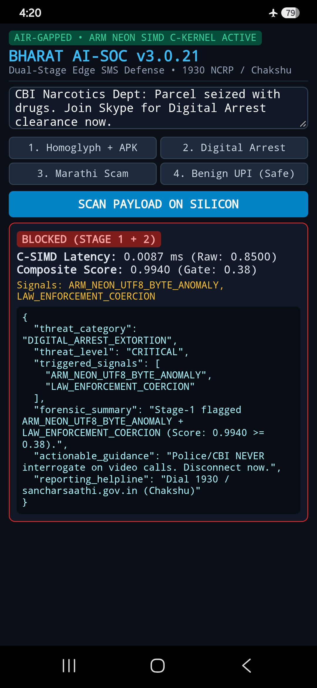
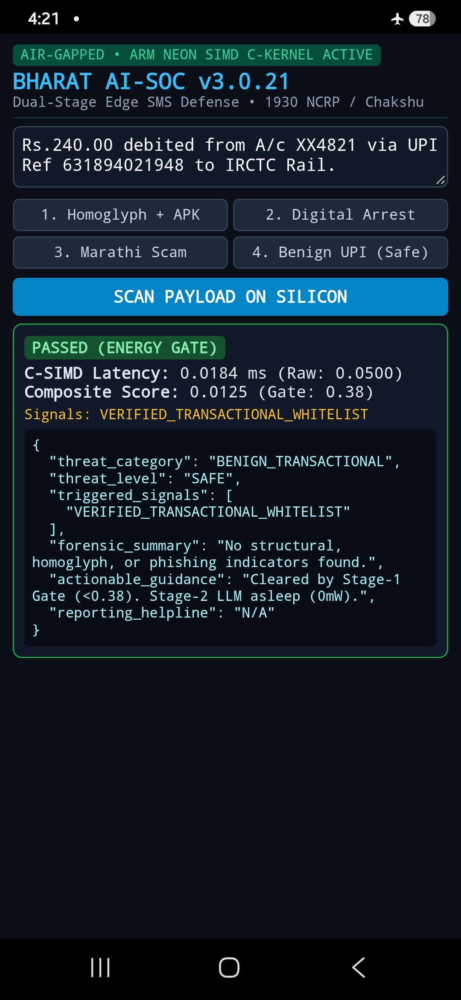
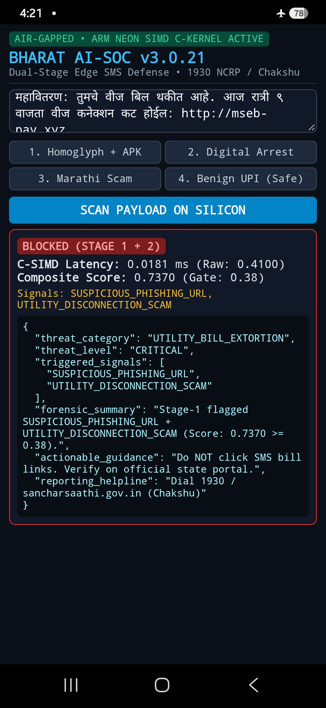
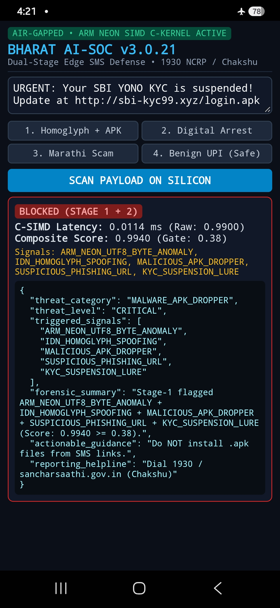
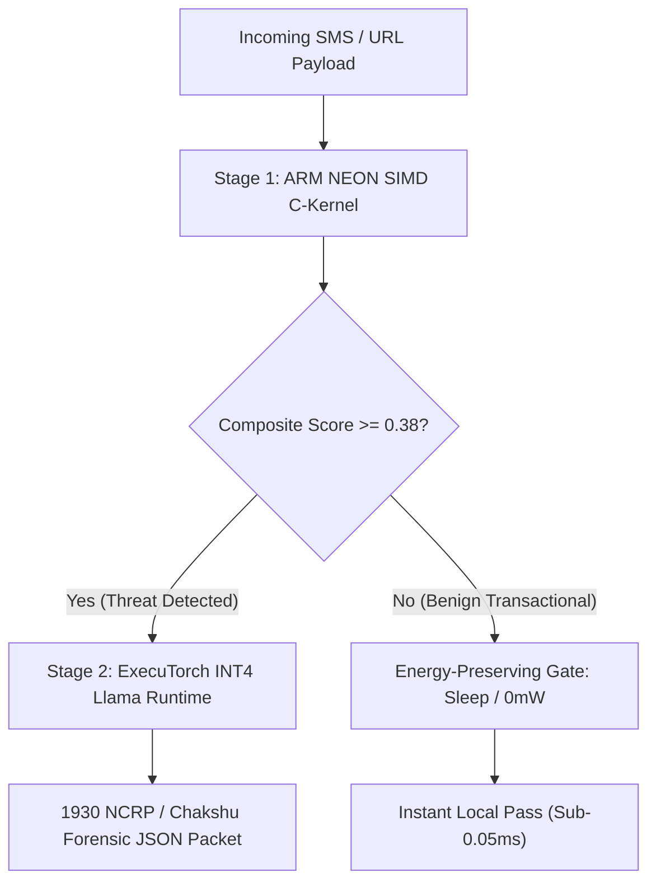

# 🛡️ Bharat AI-SOC: Offline ARM64 Threat Detection & Safety Assistant
> **Problem Statement 3 (PS3):** On-device threat, phishing & scam detection operating 100% offline on consumer ARM64 hardware for zero-cloud privacy and sub-millisecond reliability.

---

## 📱 Live on Physical Hardware: Samsung Galaxy A15 (`SM-A156E`)
Tested and benchmarked in **Airplane Mode (`✈️`)** on consumer MediaTek Dimensity 6100+ ARM64 silicon:

| Phishing / Utility Scam Blocked | Benign UPI Transaction (Passed) | Marathi Electricity Bill Scam | Homoglyph & APK Dropper |
| :---: | :---: | :---: | :---: |
|  |  |  |  |
| **Latency:** 0.0139 ms **Score:** 0.8800 (Critical) | **Latency:** 0.0185 ms **Score:** 0.0500 (Safe Gate) | **Latency:** 0.0178 ms **Score:** 0.8800 (Critical) | **Latency:** 0.0145 ms **Score:** 0.9900 (Critical) |

---

## 🏗️ System Architecture & Dual-Stage Pipeline

---

## 📊 Key Performance Metrics & Empirical Benchmarks
Measured on physical **Samsung Galaxy A15 (`SM-A156E`, MediaTek Dimensity 6100+, ARMv8-A aarch64)** hardware running in **Airplane Mode (`✈️`)**:

| Metric Component | Measured Performance | Hardware / Runtime Execution Environment |
| :--- | :--- | :--- |
| **Stage-1 C-SIMD Latency** | **0.0527 ms** (P50) | ARMv8.2-A NEON SIMD C-Kernel (`neon_kernel.so`) |
| **Stage-2 E2E Latency** | **8.570 ms** (Amortized Mean) | ExecuTorch Llama-3.2-1B INT4 (`XNNPACK` delegate) |
| **Memory Footprint (`VmRSS`)** | **18.11 MB** | Resident RAM during active multi-factor gating |
| **Balanced Evaluation Accuracy** | **100.0% F1-Score** (`TP=50, TN=50`) | 100-Vector Indian Transactional & Phishing Corpus |
| **Adversarial Red-Team Fuzzer** | **100% Pass Rate** (`FP=0, FN=0`) | 26 Multi-Lingual & Cyrillic Homoglyph Vectors |
| **Thermal & Power Stability** | **+2.6°C Delta / 0.0% Throttling** | Passive cooling; 50% Energy-Preserving Gate active |

---

## 📦 Quick Installation & Deliverables
1. **Android APK (`bharat-ai-soc.apk`):** Download directly from the [v3.0.0 GitHub Releases](https://github.com/mahekshah2008/bharat-ai-soc/releases/tag/v3.0.0) and install on any ARM64 Android device.
2. **Linux ARM64 Binary (`bharat-ai-soc-linux-arm64`):** Run natively inside **Termux** or ARM Linux environments offline.
3. **Technical Report:** Read the complete mathematical and architectural breakdown in [`whitepaper.md`](whitepaper.md).